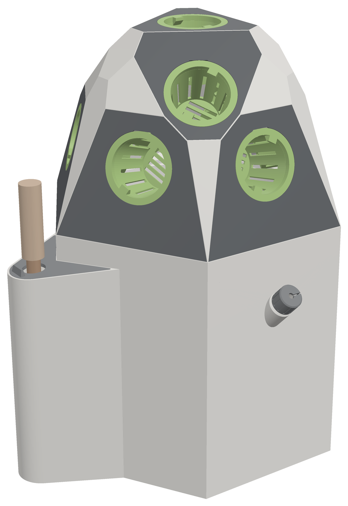
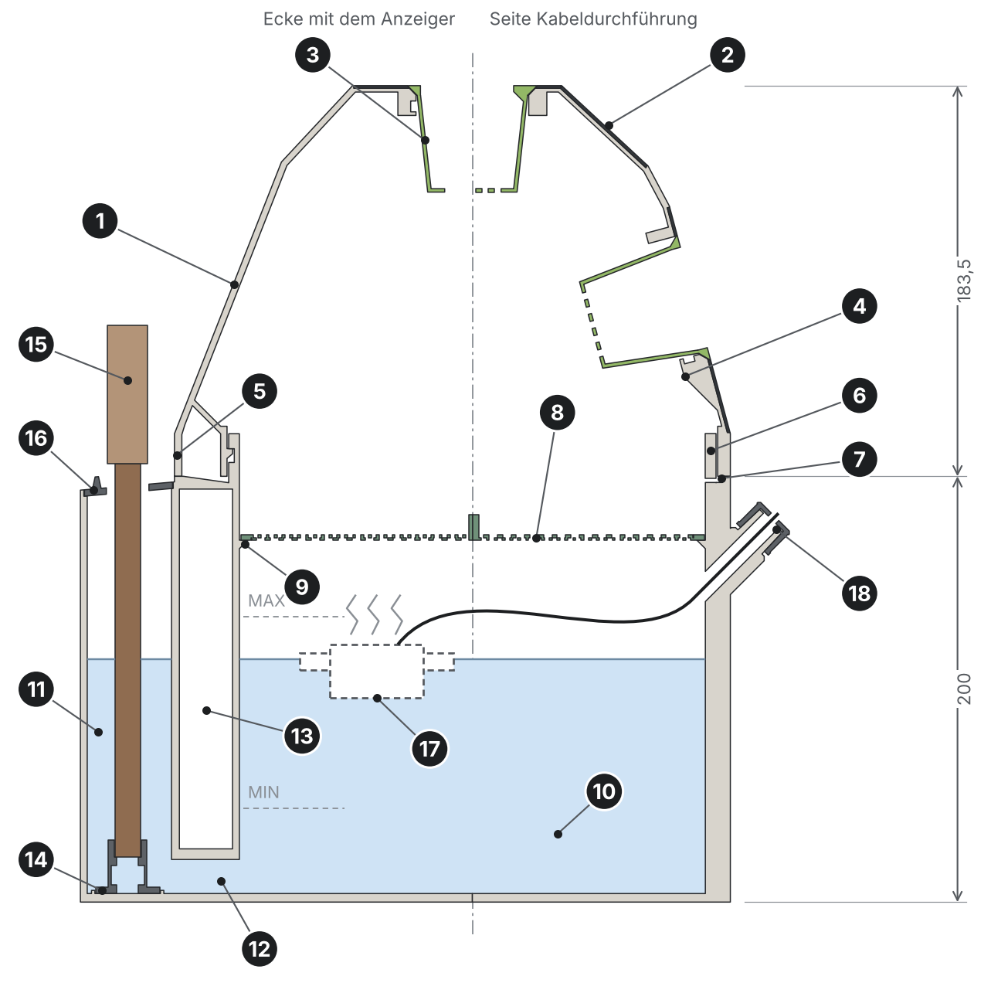
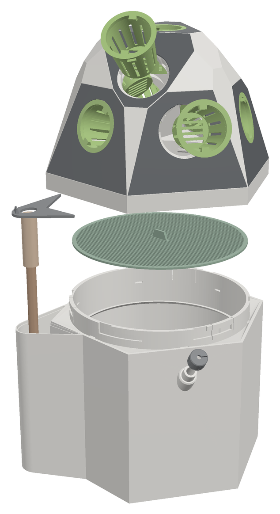
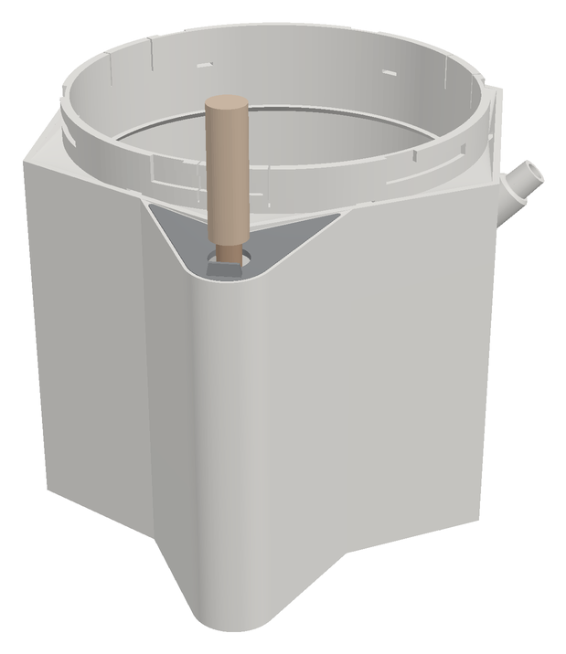

# Nebeltopf

Fogponik-Pflanzturm für zehn Pflanzen: eine facettierte Kuppel in zwei Farben auf einem Wassertank,
komplett in PETG auf dem Bambu Lab H2D gedruckt. Ohne Schrauben, ohne TPU, ohne Gewindeeinsätze.

Im Sockel steht Wasser, ein Ultraschallnebler schwimmt darauf. Der Nebel steigt durch ein Wurzelsieb in die Kuppel,
wo die Wurzeln frei in der Luft hängen. Kondenswasser läuft innen an der Kuppel herunter und über eine Rinne zurück
in den Tank. Netztöpfe und Kuppel sind per Bajonett mit Klick verriegelt. Nachgefüllt wird über eine Wasserkammer
an einer Ecke des Sockels, dort steht auch ein handelsüblicher Wasserstandsanzeiger. Die Kuppel bleibt dabei drauf.

## Eckdaten

| | |
|---|---|
| Pflanzplätze | 10 für 2"-Netztöpfe: 6 unten (15°), 3 Mitte (43°), 1 oben |
| Wasser | 5,2 l bis MAX, 1,6 l bis MIN, ca. 0,40 l pro Zentimeter |
| Höhe | 383,5 mm (Sockel 200 + Kuppel 183,5) |
| Grundfläche | 280 × 284 mm |
| Material | PETG, Kuppel zweifarbig in einem Druck |

## Dateien

| | |
|---|---|
| [`nebeltopf.scad`](nebeltopf.scad) | parametrisches OpenSCAD-Modell aller Teile |
| [`stl/`](stl) | alle Teile als STL, schon in Druckrichtung |
| [`ANLEITUNG.md`](ANLEITUNG.md) | Druckeinstellungen, Zusammenbau, Betrieb |
| [`Nebeltopf_v5_Dokumentation.pdf`](Nebeltopf_v5_Dokumentation.pdf) | Konstruktionsbeschreibung mit Schnittmodell, Designentscheidungen und Prüfung |
| [`bilder/`](bilder) | Renderings und Schnitte |

## Schnell loslegen

1. `pruefblock.stl` und einen `netztopf.stl` drucken und testen, ob der Topf sauber einrastet.
   Zu stramm oder zu locker: `SPIEL` in der .scad anpassen.
2. `sockel.stl` drucken (ohne Stützen) und einen Tag mit Wasser bis MAX stehen lassen.
3. Kuppel (`kuppel_haupt.stl` + `kuppel_farbe2.stl` als ein Objekt), Sieb, Töpfe und Kleinteile drucken.

Alles Weitere steht in der [Anleitung](ANLEITUNG.md).

**Zukauf:** Ultraschallnebler mit Schwimmer (Kabel bis Ø 5 mm), Wasserstandsanzeiger für Hydrokultur (19 cm),
optional Silikonfett.

## Schnitt

  
  

